# Transport and Storage of Fluids (Piping, Pumps, and Compressors)

This skill provides an authoritative, textbook-grounded reference on fluid transport, pipeline hydraulics, pump rating, cavitation mechanics, gas compression, and control valve sizing, based directly on Chapter 20 of *Chemical Engineering Design* (Towler & Sinnott, 2nd Edition, printed pp. 1207–1265; PDF pp. 1216–1274), supplemented with standard explicit/implicit friction-factor correlations.

---

## 1. Pipeline Fluid Dynamics & Frictional Pressure Drop

Fluid flow through commercial conduits experiences frictional resistance governed by fluid momentum, viscosity, wall roughness, and pipe geometry.

### 1.1 The Frictional Pressure-Drop Equation (Darcy–Weisbach / Coulson–Richardson)
The fundamental governing equation for frictional pressure drop in a straight, full pipe of circular cross-section is given by Towler & Sinnott **Equation 20.1** (p. 1213):

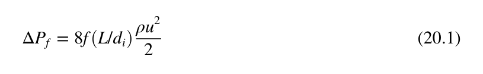

$$\Delta P_f = 8 f_{\text{T\&S}} \left(\frac{L}{d_i}\right) \left(\frac{\rho u^2}{2}\right) = 4 f_{\text{T\&S}} \left(\frac{L}{d_i}\right) \rho u^2$$
$$\text{Or in head of fluid:}$$
$$h_f = \frac{\Delta P_f}{\rho g} = 8 f_{\text{T\&S}} \left(\frac{L}{d_i}\right) \left(\frac{u^2}{2 g}\right) = f_D \left(\frac{L}{d_i}\right) \left(\frac{u^2}{2 g}\right)$$

> [!NOTE]
> **Friction Factor Conventions (Coulson–Richardson vs. Fanning vs. Darcy–Weisbach)**:
> Towler & Sinnott adopt the **Coulson & Richardson basic friction factor** $f_{\text{T\&S}} = R / (\rho u^2) = \tau_w / (\rho u^2)$ in Equation 20.1 and Figure 20.5 (p. 1214). They explicitly note **Fanning's** friction factor $C_f = 2 R / (\rho u^2) = 2 f_{\text{T\&S}}$ (**Equation 20.1b**: $\Delta P_f = 4 C_f (L/d_i)(\rho u^2/2)$). The **Darcy–Weisbach / Moody** friction factor $f_D$ used internally by Visualcheme (`src/core/thermo/friction.ts`) is related by:
> $$f_D = 4 C_f = 8 f_{\text{T\&S}}$$

---

### 1.2 Flow Regimes & Friction Factor Correlations
Flow is characterized by the dimensionless **Reynolds number** (**Equation 20.2**, p. 1214):

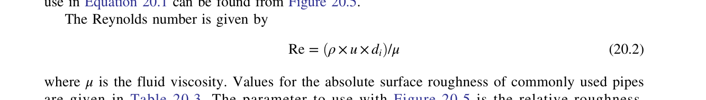

$$Re = \frac{\rho u d_i}{\mu} = \frac{u d_i}{\nu}$$

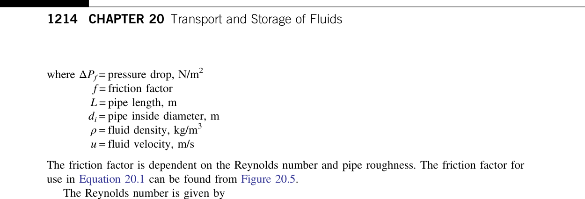

*(Figure 20.5, p. 1215 plots $f_{\text{T\&S}} = f_D / 8$ against $Re$ and relative roughness $e = \varepsilon / d_i$.)*

#### 1.2.1 Laminar Regime ($Re < 2300$, Hagen–Poiseuille)
Viscous shear completely dominates; surface roughness has no effect:
$$f_D = \frac{64}{Re} \quad \Longleftrightarrow \quad C_f = \frac{16}{Re} \quad \Longleftrightarrow \quad f_{\text{T\&S}} = \frac{8}{Re}$$

#### 1.2.2 Turbulent Regime ($Re \ge 4000$, Colebrook–White)
Turbulent eddies dissipate energy against wall asperities. The implicit **Colebrook–White equation** (standard analytical basis of Moody / Figure 20.5, external to Towler's numbered equations) is written in Darcy ($f_D$) and Fanning ($C_f$) forms as:
$$\frac{1}{\sqrt{f_D}} = -2.0 \log_{10} \left[ \frac{\varepsilon / d_i}{3.7} + \frac{2.51}{Re \sqrt{f_D}} \right] \qquad \left(\text{or }\frac{1}{\sqrt{C_f}} = -4.0 \log_{10} \left[ \frac{\varepsilon / d_i}{3.7} + \frac{1.255}{Re \sqrt{C_f}} \right]\right)$$

#### 1.2.3 Universal Explicit Formulation: The Churchill Equation (1977)
To avoid implicit root-solving iterations across laminar, transition, and fully turbulent regimes, Churchill (1977) developed a single continuous explicit correlation (in Darcy form $f_D$, divide by 4 for Fanning $C_f$ or by 8 for $f_{\text{T\&S}}$):
$$f_D = 8 \left[ \left(\frac{8}{Re}\right)^{12} + \frac{1}{(A + B)^{1.5}} \right]^{1/12}$$
$$\text{Where:}$$
$$A = \left[ 2.457 \ln \left( \frac{1}{(7/Re)^{0.9} + 0.27 (\varepsilon / d_i)} \right) \right]^{16}, \qquad B = \left( \frac{37,530}{Re} \right)^{16}$$

#### 1.2.4 Standard Pipe Surface Roughness ($\varepsilon$) (**Table 20.3**, p. 1216):
* Drawn tubing (brass, copper, plastic): $\varepsilon = 0.0015\text{ mm}$
* Commercial steel pipe: $\varepsilon = 0.046\text{ mm}$
* Cast iron pipe: $\varepsilon = 0.26\text{ mm}$
* Concrete pipe: $\varepsilon = 0.3\text{–}3.0\text{ mm}$
* *(Standard external Moody values also used in Visualcheme: stainless steel $0.015\text{ mm}$, galvanized iron $0.15\text{ mm}$.)*

---

### 1.3 Minor Losses in Pipe Fittings and Valves
Flow through bends, tees, reducers, and valves experiences flow separation and secondary vortex dissipation (Section 20.4.2, pp. 1216–1218; Section 20.5, pp. 1219–1221).

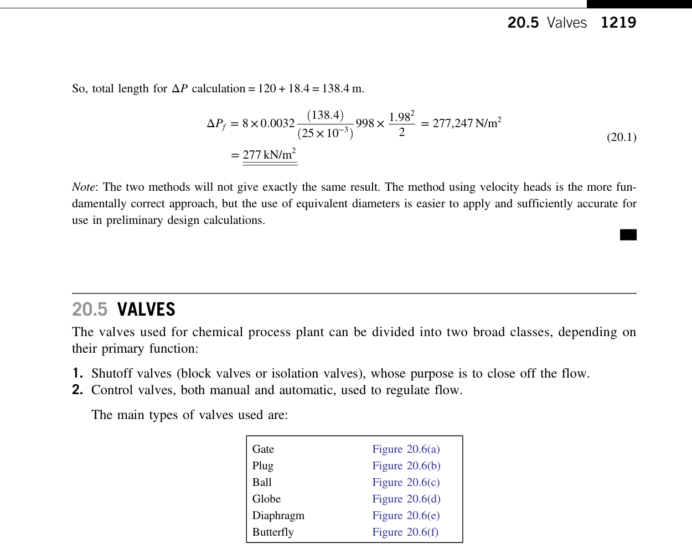

Minor losses are evaluated either via the number of velocity heads $K$ (more fundamentally correct) or the equivalent length of straight pipe $(L_e/d_i)$:
$$\Delta P_m = K \left( \frac{\rho u^2}{2} \right) = f_D \left( \frac{L_e}{d_i} \right) \left( \frac{\rho u^2}{2} \right) = 8 f_{\text{T\&S}} \left( \frac{L_e}{d_i} \right) \left( \frac{\rho u^2}{2} \right)$$

#### Representative Loss Values for Turbulent Flow (**Table 20.4**, p. 1217):
* **Gate valve (fully / ¾ / ½ / ¼ open)**: $K = 0.15 / 1 / 4 / 16$, $L_e/d_i = 7.5 / 40 / 200 / 800$
* **Globe valve, bevel seat (fully / ½ open)**: $K = 6 / 8.5$, $L_e/d_i = 300 / 450$
* **Globe valve, plug disk (fully / ½ / ¼ open)**: $K = 9 / 36 / 112$, $L_e/d_i = 450 / 1800 / 5600$
* **Plug valve (open)**: $K = 0.4$, $L_e/d_i = 18$ *(Note: Visualcheme's quarter-turn ball valve $K = 0.05$ open uses Weisbach plug-cock data)*
* **45° standard / long-radius elbow**: $K = 0.35 / 0.2$, $L_e/d_i = 15 / 10$
* **90° standard radius elbow**: $K = 0.6\text{–}0.8$, $L_e/d_i = 30\text{–}40$
* **90° long-radius elbow**: $K = 0.45$, $L_e/d_i = 23$
* **90° square elbow**: $K = 1.5$, $L_e/d_i = 75$
* **Tee (entry from leg / entry into leg)**: $K = 1.2 / 1.8$, $L_e/d_i = 60 / 90$
* **Sharp reduction (tank outlet / pipe entrance)**: $K = 0.5$, $L_e/d_i = 25$
* **Sudden expansion (tank inlet / pipe exit)**: $K = 1.0$, $L_e/d_i = 50$

---

## 2. Economic Pipe Diameter Selection (Section 20.10, pp. 1248–1255)

Sizing pipelines involves an economic optimization balancing annualized capital & maintenance cost against operating pumping power cost.

### 2.1 Typical Pipe Velocities & Allowable Pressure Drops (**Section 20.10**, p. 1248)
| Process Fluid Service | Towler Section 20.10 Guidance | Typical Pressure Drop / Design Reason |
| :--- | :--- | :--- |
| **Liquids, pumped (not viscous)** | **$1\text{–}3\text{ m/s}$** (Rase: discharge $0.06 d_i + 0.4\text{ m/s}$; suction $0.02 d_i + 0.1\text{ m/s}$, $d_i$ in mm) | $\Delta P \approx 0.5\text{ kPa/m}$; common design bands: **$0.5\text{–}1.5\text{ m/s}$ suction** (preserves $NPSH_a$) and **$1.5\text{–}3.0\text{ m/s}$ discharge**. |
| **Liquids, gravity flow** | Low self-venting velocity | $\Delta P \approx 0.05\text{ kPa/m}$. |
| **Gases and vapors** | **$15\text{–}30\text{ m/s}$** (Rase: $0.2 d_i\text{ m/s}$) | $\Delta P \approx 0.02\%$ of line pressure; stay below $30\%$ of sonic velocity. |
| **High-pressure steam ($>8\text{ bar}$)** | **$30\text{–}60\text{ m/s}$** | Prevents excessive heat loss and erosion. |

*(Note: Table 20.1 on p. 1210 covers operating ranges of compressors and blowers, not pipe velocities.)*

---

### 2.2 Economic Optimum Pipe Diameter (**Equations 20.29–20.31**, pp. 1251–1252)
Minimizing total annualized piping plus pumping cost ($C_t = C_C + C_w$, using Genereaux's $C_f = 0.04\,Re^{-0.16}$) yields the general optimum diameter **Equation 20.29**:

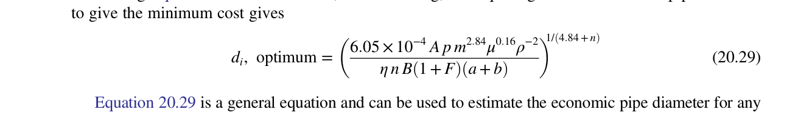

Substituting typical plant attainment ($8000\text{ h/yr}$), power cost, and A106 carbon steel / 304 stainless steel installed pipe cost correlations gives **Equations 20.30 and 20.31** (SI units: $\dot{m}$ in $\text{kg/s}$, $\rho$ in $\text{kg/m}^3$, $d_{i,\text{opt}}$ in $\text{m}$):

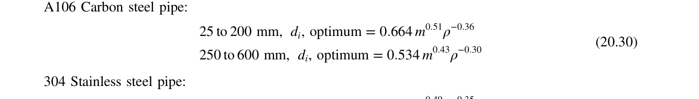

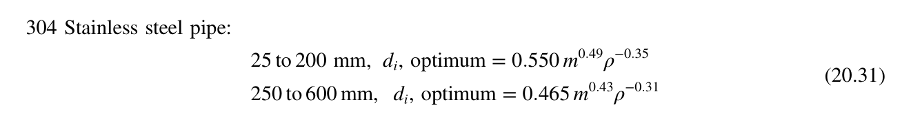

* **A106 Carbon Steel (Eq. 20.30)**:
  * $25\text{–}200\text{ mm}$: $d_{i,\text{opt}} = 0.664\,\dot{m}^{0.51}\rho^{-0.36}$
  * $250\text{–}600\text{ mm}$: $d_{i,\text{opt}} = 0.534\,\dot{m}^{0.43}\rho^{-0.30}$
* **304 Stainless Steel (Eq. 20.31)**:
  * $25\text{–}200\text{ mm}$: $d_{i,\text{opt}} = 0.550\,\dot{m}^{0.49}\rho^{-0.35}$
  * $250\text{–}600\text{ mm}$: $d_{i,\text{opt}} = 0.465\,\dot{m}^{0.43}\rho^{-0.31}$
* **Refinery rule of thumb (p. 1249)**: $d_{i,\text{opt}} = 3.2\,(\dot{m}/\rho)^{0.5}$ ($\text{m}$).

---

## 3. Centrifugal Pumps & Hydraulic System Design (Section 20.7, pp. 1230–1243)

Centrifugal pumps convert shaft rotational kinetic energy from an electric motor or steam turbine into fluid static pressure and head via a high-speed rotating impeller and diffuser volute (see **Table 20.2** & **Figure 20.3**, p. 1212 for pump selection).

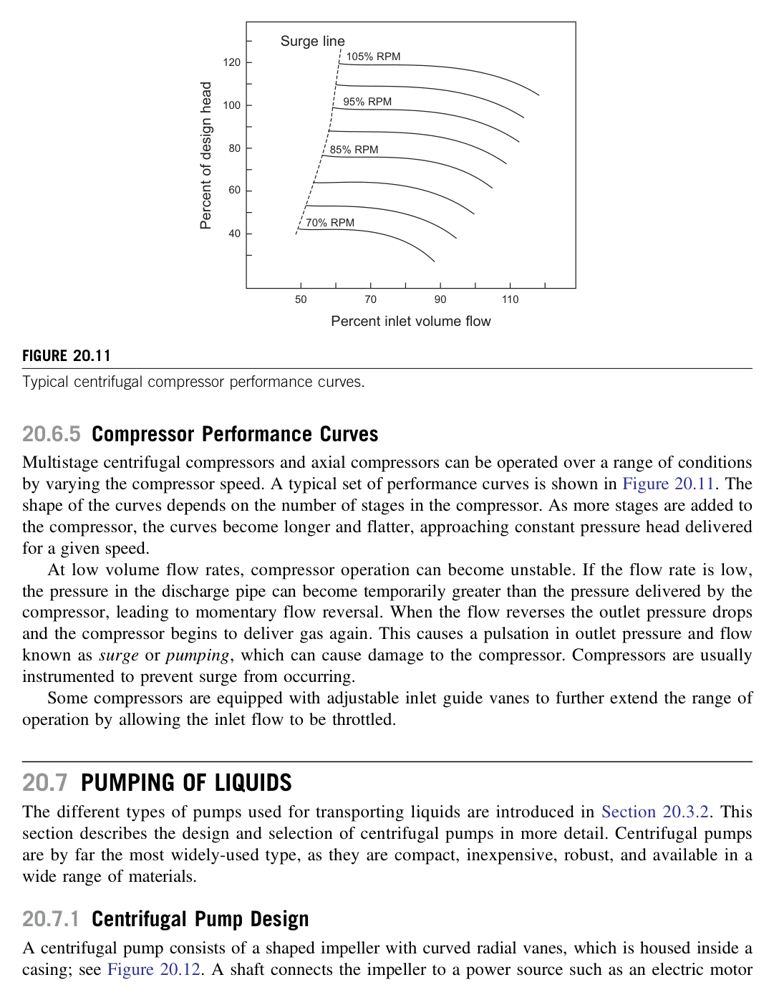

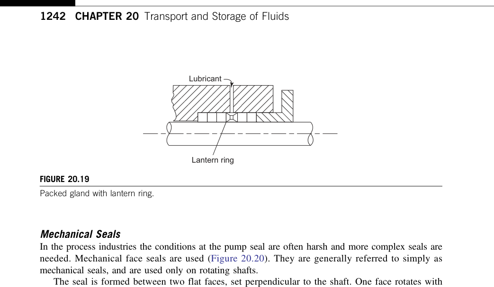

### 3.1 Pump Characteristic Curves ($H\text{–}Q$), Specific Speed & Power
Pump manufacturers test pumps at constant rotational speed with water to produce characteristic curves (**Figure 20.15**, p. 1235; family of curves **Figure 20.16**, p. 1236):

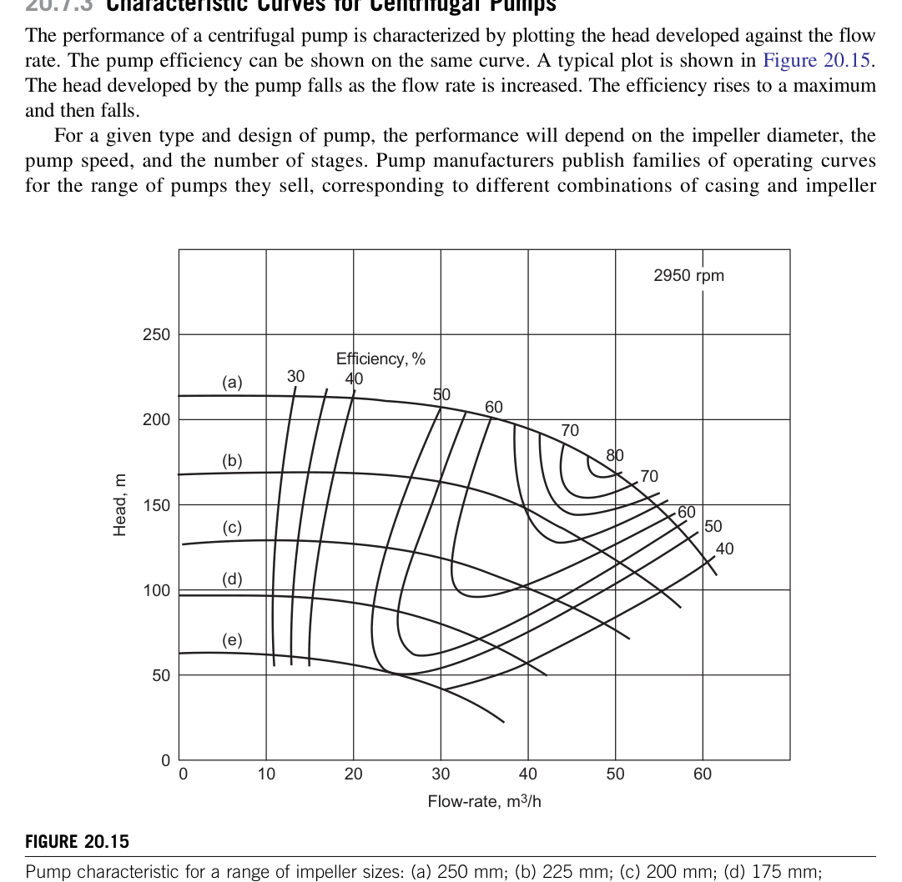

1. **Head–Capacity ($H\text{–}Q$) Curve**: Total head developed $H$ falls as volumetric discharge $Q$ increases (same head for any liquid with $\mu < 50\text{ cP}$, p. 1236).
2. **Efficiency ($\eta_p$) Curve**: Rises to a maximum at the **Best Efficiency Point (BEP)** (see preliminary chart **Figure 20.14**, p. 1233) and declines at off-design flows.
3. **Specific Speed** (**Equations 20.14–20.15**, p. 1231):
   $$N_s = \frac{N Q^{1/2}}{(g h)^{3/4}}, \qquad N'_S = \frac{N' Q_{\text{gpm}}^{1/2}}{h_{\text{ft}}^{3/4}}$$
4. **Brake Power ($P_B$)** (**Equations 20.18–20.19**, p. 1233; motor input **Equation 20.22** & **Table 20.5**, p. 1244):

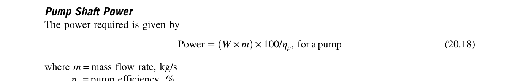

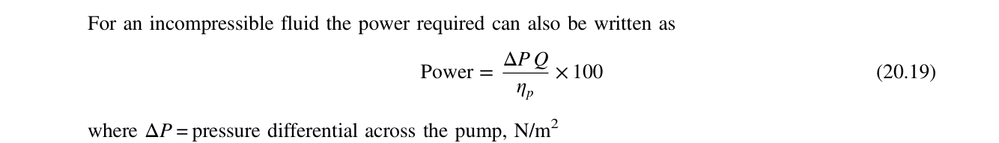

$$P_B = \frac{\dot{m} g H}{\eta_p} = \frac{\rho g Q H}{\eta_p} = \frac{\Delta P\,Q}{\eta_p} \quad (\text{with }\eta_p\text{ as fraction})$$

---

### 3.2 System Resistance Curve & Operating Point (Sections 20.7.2 & 20.7.5)
A piping system requires head to overcome static elevation, vessel pressure difference, and pipeline/fitting/equipment friction:

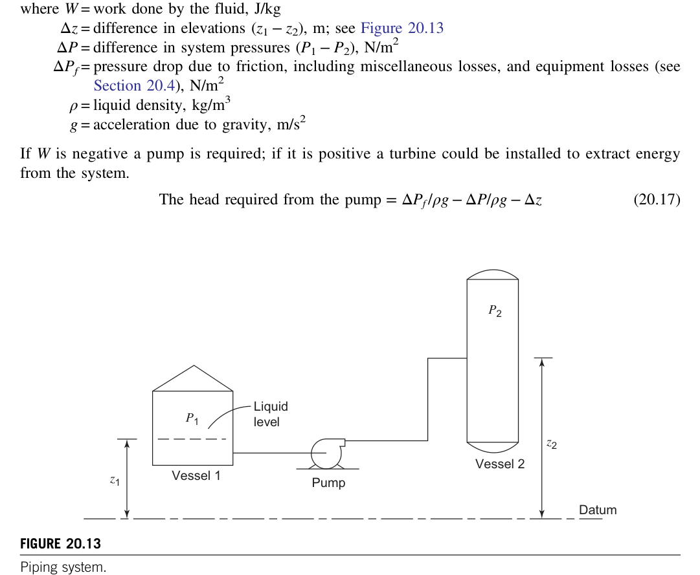

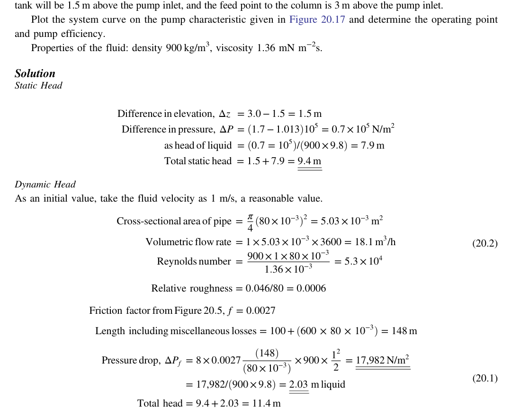

The mechanical energy balance and required pump head (**Equations 20.16 & 20.17**, p. 1232, where Towler defines $\Delta z = z_1 - z_2$, $\Delta P = P_1 - P_2$, and $W < 0$ for a pump):

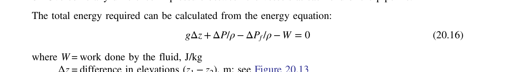

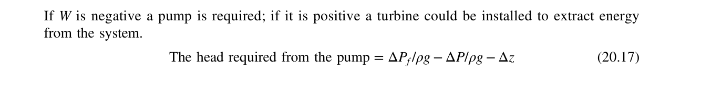

$$g(z_1 - z_2) + \frac{P_1 - P_2}{\rho} - \frac{\Delta P_f}{\rho} - W = 0$$
$$H_{\text{sys}} = (z_2 - z_1) + \frac{P_2 - P_1}{\rho g} + \frac{\Delta P_f}{\rho g} = H_{\text{static}} + \sum h_f + \sum h_m$$
* **Operating Point**: The unique intersection where $H_{\text{pump}}(Q) = H_{\text{sys}}(Q)$ (**Figure 20.17**, Example 20.8, p. 1240).

---

### 3.3 Net Positive Suction Head (NPSH) & Cavitation Prevention (Section 20.7.4, pp. 1236–1238)
Cavitation occurs when local static pressure inside the pump drops below the fluid's saturation vapor pressure $P_v$ at operating temperature. Vapor bubbles form and collapse violently in higher-pressure impeller zones, causing noise, pitting, erosion, and mechanical seal damage.

#### 3.3.1 NPSH Available ($NPSH_{\text{avail}}$) (**Equation 20.21**, p. 1237)
The absolute pressure head available at the pump suction nozzle above vapor pressure:

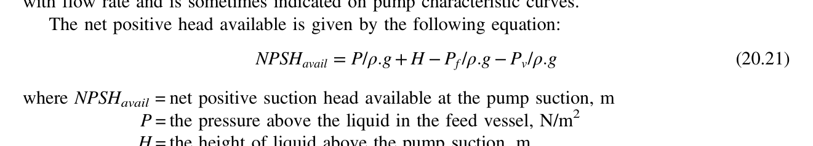

$$NPSH_{\text{avail}} = \frac{P}{\rho g} + H - \frac{P_f}{\rho g} - \frac{P_v}{\rho g}$$
Where:
* $P$ = Absolute pressure above the liquid in the suction feed vessel ($\text{N/m}^2$)
* $P_v$ = Fluid saturation vapor pressure at pump suction temperature ($\text{N/m}^2$)
* $H$ ($z_1$ in Visualcheme) = Height of liquid surface above the pump suction centerline ($\text{m}$, positive if vessel is above pump; negative for suction lift)
* $P_f$ = Frictional and minor pressure loss in the suction piping ($\text{N/m}^2$)

#### 3.3.2 NPSH Required ($NPSH_{\text{reqd}}$) & Safety Margin
* $NPSH_{\text{reqd}}$ is specified by the pump manufacturer and increases with flow rate $Q$.
* **Design Rules**: $NPSH_{\text{avail}} > NPSH_{\text{reqd}}$ under all operating conditions (typical margin $\ge 0.5\text{ m}$ for stable liquids, $\ge 1.5\text{ m}$ near bubble point; Towler p. 1236 notes general target $NPSH > 3\text{ m}$ for $Q \le 100\text{ m}^3/\text{h}$ and $> 6\text{ m}$ above $100\text{ m}^3/\text{h}$).

---

## 4. Gas Compression & Multistage Systems (Section 20.6, pp. 1221–1230)

Compressors increase the pressure of compressible gases for transmission, reaction, or refrigeration (**Table 20.1**, p. 1210; **Figure 20.1**, p. 1209).

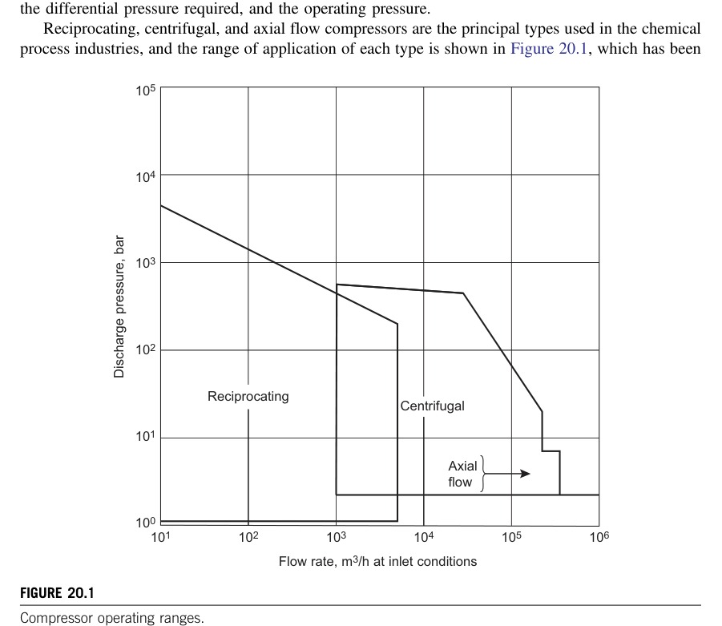

### 4.1 Thermodynamic Compression Paths
1. **Polytropic Compression ($P v^n = \text{constant}$, Equations 20.7, 20.9, 20.10, 20.12, pp. 1222–1225)**:

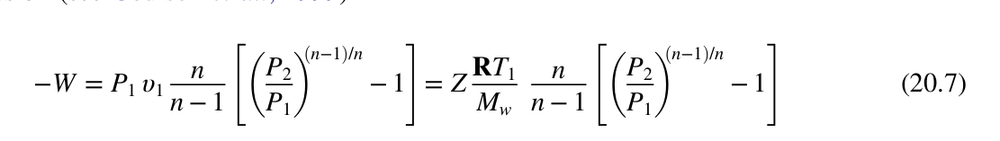

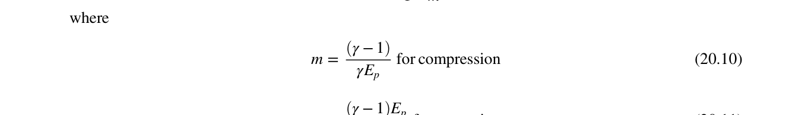

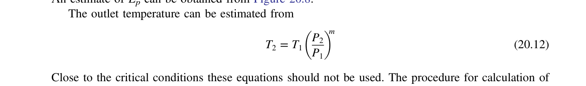

$$-W = Z \frac{R T_1}{M_w} \left(\frac{n}{n - 1}\right) \left[\left(\frac{P_2}{P_1}\right)^{(n-1)/n} - 1\right], \qquad n = \frac{1}{1 - m}, \qquad m = \frac{\gamma - 1}{\gamma E_p}$$
$$T_2 = T_1 \left(\frac{P_2}{P_1}\right)^m$$
*(Set $n = \gamma$, $E_p = 1$ for reversible isentropic compression; isothermal ideal gas work is **Equation 20.5**, p. 1222.)*

---

### 4.2 Multi-Stage Compression with Intercooling (Section 20.6.4, p. 1229)
At high pressure ratios, single-stage discharge temperature becomes excessive; compression is split across $N$ stages with intercooling and equal compression ratios $r_p = (P_{\text{out}}/P_{\text{in}})^{1/N}$ for equal stage work. For two stages (**Equation 20.13**, p. 1229):

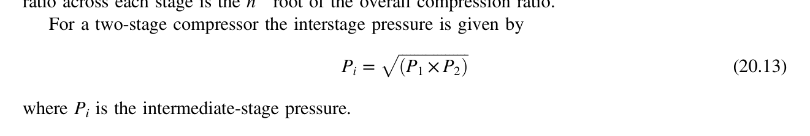

$$P_i = \sqrt{P_1 P_2}$$

*(Centrifugal compressor performance curves & surge limit are shown in **Figure 20.11**, p. 1230.)*

---

## 5. Control Valve Sizing ($C_v$) (Section 20.11, pp. 1256–1259)

Control valves throttle process flow to regulate downstream pressure, level, temperature, or flow rate. Allow $\ge 30\%$ of total dynamic pressure drop (minimum $100\text{ kPa}$, early-design rule of thumb $140\text{ kPa}$ / $20\text{ psi}$).

### 5.1 Liquid Valve Flow Coefficient ($C_v$) (**Equation 20.32**, p. 1258)
For non-choked, turbulent flow of an incompressible liquid (ISA 75.01.01-2007):

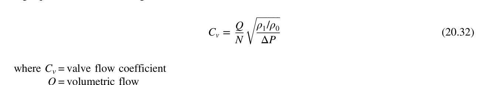

$$C_v = \frac{Q}{N}\sqrt{\frac{\rho_1 / \rho_0}{\Delta P}}$$
* $N = 1$ when $Q$ is in US $\text{gpm}$ and $\Delta P$ is in $\text{psi}$ ($\rho_0$ = water at $15\,^\circ\text{C}$).
* $N = 0.865$ when $Q$ is in $\text{m}^3/\text{h}$ and $\Delta P$ is in $\text{bar}$ (giving $C_v = 1.156\,Q\sqrt{\text{SG}/\Delta P}$).
* Compressible/choked gas sizing, flashing liquids, and cavitation follow the full ISA S75.01 standard (external to Towler Ch. 20 equations).

---

## 6. Visualcheme Implementation Architecture

1. **State Variables**: `PipeUnit` integrates steady 1D liquid balances along 201 stations ($P, T, h_L, \Delta P_{\text{friction}}$) with temperature-dependent DIPPR/ChemSep properties (`PropertyService.getLiquidState`) and Darcy friction factor $f_D$ (`FrictionSolver`).
2. **Interactive Visualization Gradients**:
   * *Hydraulic & Energy Grade Lines (HGL / EGL)*: Dynamic spatial profiles $z + P/(\rho g)$ and $\text{HGL} + v^2/(2g)$, displaying point drops across fittings/valves, pump jumps, and vessel boundaries.
   * *Cavitation & Flashing Indicators*: Pump casing status color + collapsing bubbles when $NPSH_a < NPSH_r$, and growing vapor bubbles downstream of $P \le P^{\text{sat}}(T)$.
   * *Velocity Profile Visualization*: Parabolic laminar flow ($u/\bar{v} = 2(1 - r^2/R^2)$) transitioning to turbulent $1/n$ power law ($n = 1/\sqrt{f_D}$).
3. **Theoretical Documentation**: Complete derivation, textbook contrast (Towler & Sinnott vs. Seider et al.), and UI traceability live in `docs/theory/`.
