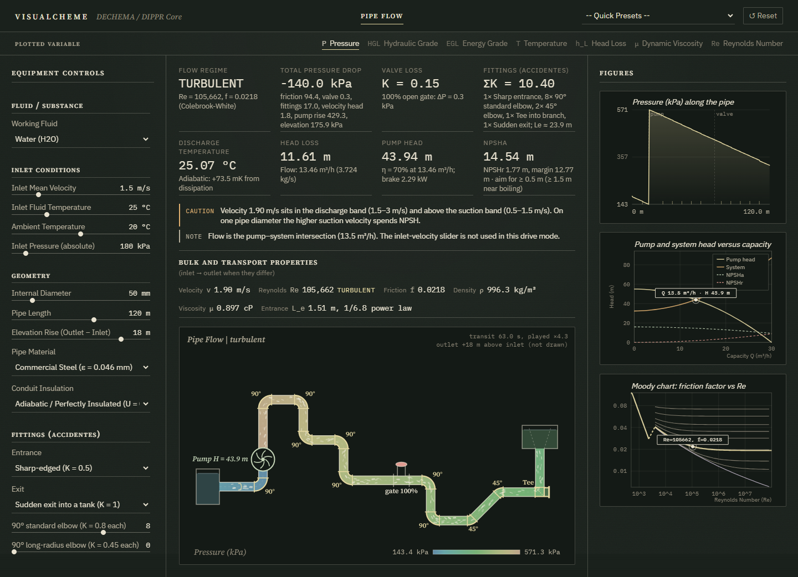
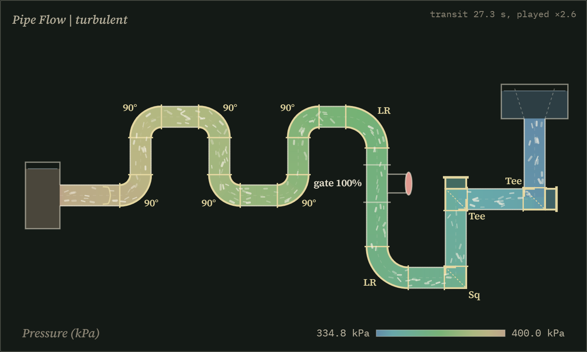
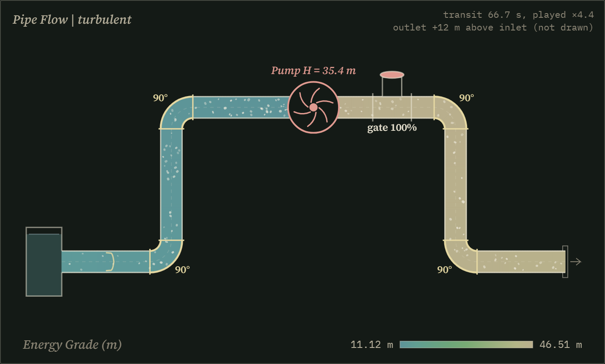
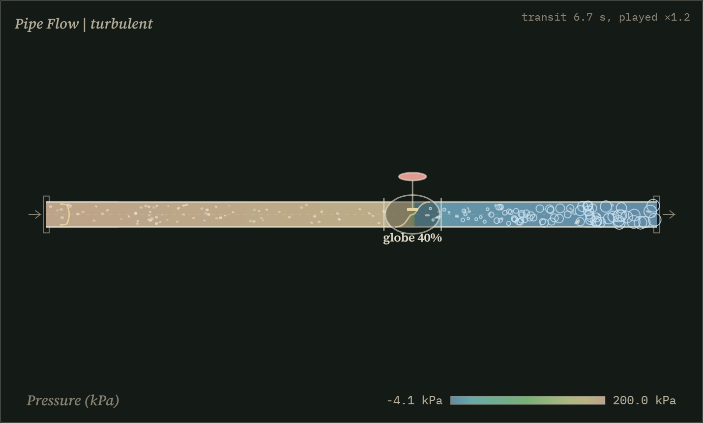
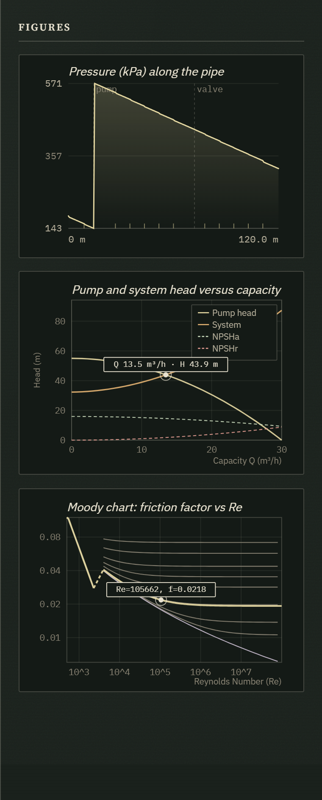
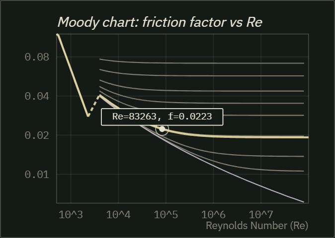

# Visualcheme

> **Interactive, Didactic Chemical Engineering Unit Simulation & Physical Gradient Visualizer**  
> *Transforming black-box chemical engineering simulations into transparent, real-time, visual physical intuition.*



---

## 1. What is Visualcheme?

**Visualcheme** is an open-source, web-first, real-time chemical engineering simulation and visualization platform. 

Unlike traditional process simulators (e.g., Aspen Plus, HYSYS, DWSIM, PRO/II) that operate as **point-state black boxes**—where users input stream specifications, press *Run*, and inspect static numerical tables—Visualcheme focuses on **spatial continuity, fluid dynamics, and thermodynamic transitions inside the equipment itself**:

* **Live 2D/3D Internal Physics**: Equipment models display dynamic velocity profiles, boundary layers, thermal gradients, phase changes, and turbulent dissipation.
* **User-Selected Spatial Heatmaps**: The user dynamically selects which physical property drives the internal color gradient and 1D profile of the unit (Pressure $P$, Temperature $T$, head loss $h_L$, or the hydraulic grade line).
* **Dedicated Bulk Transport HUD**: Transport properties (Mean Velocity $v$, Reynolds Number $Re$, Darcy Friction Factor $f$, Density $\rho$, and Viscosity $\mu$) are shown at inlet and outlet, since they follow the local temperature along the conduit.
* **Model Validity Diagnostics**: Every unit reports when its assumptions break (e.g. a liquid flashing below its vapor pressure), so learners see where a model stops being physical.
* **Synchronized Interactive Diagrams**: Sliders immediately update both the visual unit model and classical chemical engineering diagnostic plots (e.g., Moody friction factor diagram, spatial 1D profiles, McCabe-Thiele operating lines, T-x-y phase envelopes).
* **60 FPS Reactivity**: All numerical solvers execute in sub-millisecond times natively in the client, allowing smooth, instant feedback when adjusting parameters.

### Screenshots

**Fittings drawn as real bends.** Standard elbows turn at a centreline radius of 1 D, long-radius (LR) elbows at 1.5 D, square elbows and tees are mitred, and tees carry a capped dead leg. The heatmap steps down at each fitting by its K ρv²/2 loss. Hover any point for its position, value, and the fitting there.



**Pump on the line, coloured by NPSH margin.** Here the energy grade line is plotted: flat in the suction vessel, falling through the suction line, jumping by the pump head, then falling again. The pump casing turns red because NPSHa is below NPSHr.



**Flashing downstream of a throttled valve.** Once the pressure falls below the vapor pressure, vapor bubbles form and grow toward the outlet, and the validity panel flags that the single-phase model no longer holds.



<table>
<tr>
<td width="48%"></td>
<td>

**Synchronized figures.** The 1D profile marks where the pump and valve sit, the pump chart places the duty point where the pump curve crosses the system curve, and the Moody chart follows the current pipe's roughness.

The dashed stretch between Re = 2300 and 4000 is the transition zone, where the friction factor is not determinate. The Colebrook and Swamee-Jain options bridge it by interpolation, so it is drawn dashed; Churchill is a single published equation and stays solid.



</td>
</tr>
</table>

---

## 2. Why Are We Building It?

### The "Black Box" Problem in Chemical Engineering Education & Industry
1. **Lack of Spatial Intuition**: Standard simulators tell you *what* enters and *what* leaves, but they obscure *how* and *where* pressure drops occur, how boundary layers develop, where heat transfer bottlenecks arise, or where thermodynamic irreversibilities are concentrated.
2. **Hidden Irreversibility**: Engineers frequently close an energy balance and still miss where the flow is irreversible. Second-law exergy is a later study; the pipe module now stays with friction, fittings, grade lines, and the pump.
3. **High Barriers to Entry**: Commercial tools require expensive proprietary licenses, hefty multi-gigabyte installations, and specialized environments. Visualcheme runs **100% locally in any modern web browser** with zero installation, zero server dependencies, and zero setup lag.

---

## 3. How Does It Work?

### Architecture Overview

```
┌────────────────────────────────────────────────────────────────────────┐
│                        VISUALCHEME FRONTEND                            │
│  - Vanilla CSS Modern HUD (Dark Mode, Glassmorphic Glass Panels)       │
│  - Responsive 60 FPS Canvas / WebGL Render Engine                      │
│  - Interactive Diagnostic SVG Charts (Moody, Spatial 1D, Phase Curves) │
└───────────────────────────────────┬────────────────────────────────────┘
                                    │ Direct in-memory calls (<1 ms)
┌───────────────────────────────────▼────────────────────────────────────┐
│                  NATIVE TYPESCRIPT SIMULATION ENGINE                   │
│  - Hydrodynamics: Darcy-Weisbach, Colebrook-White, minor losses        │
│  - Thermodynamics: Enthalpy/Entropy balances, Flash algorithms         │
│  - Pipe march: friction, fittings, grade lines, pump and NPSH           │
└───────────────────────────────────┬────────────────────────────────────┘
                                    │ Pure-component & binary queries
┌───────────────────────────────────▼────────────────────────────────────┐
│                    DIPPR® 801 & DECHEMA DATABASE                       │
│  - 431 Pure Species: DIPPR 101/105/106/107, critical points, Antoine   │
│  - 352 Binary Pairs: Experimental DECHEMA NRTL activity parameters     │
│  - High-Pressure VLE: Peng-Robinson kij binary interaction matrix      │
└────────────────────────────────────────────────────────────────────────┘
```

### 1. High-Fidelity Thermodynamic Core
Visualcheme uses the exact same peer-reviewed experimental databases powering industrial simulation tools:
* **Pure Components (`compounds.json`)**: 431 chemical species parameterized from **DIPPR® 801** correlations (vapor pressure DIPPR 101, liquid density Rackett DIPPR 105, latent heat DIPPR 106, heat capacities).
* **Binary Interaction Parameters (`binary_nrtl.json`)**: 352 experimentally regressed pairs from the **DECHEMA Chemistry Data Series** (*Vapour-Liquid Equilibrium Data Collection* by J. Gmehling & U. Onken).
* **High-Pressure EOS (`binary_pr.json`)**: Peng-Robinson binary interaction matrix $k_{ij}$.
* **TypeScript Property Service (`property_service.ts`)**: Evaluates property models on the fly in microsecond speed without any backend network roundtrips.

### 2. Extensible Unit Operation Design
All equipment units implement a common, modular interface:
1. **Parameter Definitions**: Sliders (pipe diameter, length, roughness, valve throttling, heat duty, inlet temperatures) and selectors (fluid species, flow regimes).
2. **1D Spatial Discretization**: The unit is sliced into $N$ spatial control volumes along its coordinate $x \in [0, L]$, tracking the local vector:
   $$\vec{\Psi}(x) = \left[ P(x),\, T(x),\, v(x),\, \rho(x),\, \mu(x),\, Re(x),\, f(x),\, h_L(x),\, \frac{d\dot{E}x_{dest}}{dx} \right]$$
3. **Visual Heatmap Mapping**: Any state element in $\vec{\Psi}(x)$ can be mapped to an HSL color spectrum applied directly to the unit canvas representation.
4. **Synchronized Diagnostic Charts**: Real-time operating points projected onto canonical engineering curves.

---

## 4. Equipment Roadmap

Visualcheme follows a modular, bottom-up roadmap starting from foundational transport phenomena and building up to multi-stage separation columns:

The active build is **pipe flow**: straight-pipe friction, fittings (accidentes), the hydraulic and energy grade lines, and a centrifugal pump with its system curve, operating point, and NPSH. Later equipment stays in the knowledge base.

### Phase 1: Pipe flow (active)
* **Pipe, fittings, and centrifugal pump** (implemented, validated in `tests/`)
  * Darcy-Weisbach friction with selectable Colebrook-White / Swamee-Jain / Churchill correlations across laminar, transition, and turbulent regimes.
  * Fully developed velocity profiles (Hagen-Poiseuille parabola; turbulent power law with $n \approx 1/\sqrt{f}$) and hydrodynamic entrance length.
  * Fittings along the line: elbows, tees, sharp / rounded / re-entrant entrance, and sudden exit, each as a K drop on the pressure and head profiles.
  * In-line gate, globe, and ball valves (Towler Table 20.4), including partial opening.
  * Centrifugal pump curve $H = H_0(1-(Q/Q_{max})^2)$, system curve, operating point, brake power, and $NPSH_a$ versus $NPSH_r$.
  * Hydraulic grade line $z+P/(\rho g)$ and energy grade line (grade plus $v^2/2g$), with still vessels at the ends: the entrance accelerates the liquid by one velocity head, and a sudden exit loses it in the tank.
  * Routed pipe drawing: every elbow and tee turns the line at its true bend radius, with tracer particles that follow the radial velocity profile, mix turbulently, drift outward in bends, squeeze through the valve, and show cavitation and flashing as bubbles.
  * Elevation change: pressure drop versus irreversible head loss.
  * RK4 marching of the momentum and liquid energy balances with local, temperature-dependent properties.
  * Validity diagnostics: freezing, flashing, valve cavitation, NPSH margin, transitional flow, a pump that cannot meet the static head.

### Phase 2: Heat Transfer & Phase Separation
* **Unit 3: Shell & Tube Heat Exchanger**
  * Kern and Bell-Delaware rating methods, TEMA geometries, counter-current vs. co-current $F_T$ factor.
  * Spatial tube-side and shell-side temperature profiles $T_h(x)$ and $T_c(x)$.
* **Unit 4: Phase Separators & Knockout Drums**
  * Souders-Brown terminal vapor velocity ($v_{max} = K_{SB} \sqrt{\frac{\rho_L - \rho_V}{\rho_V}}$), demister pad sizing, Stokes liquid-liquid decanter settling.

### Phase 3: Staged Separation Operations
* **Unit 5: Binary & Multicomponent Distillation Column**
  * McCabe-Thiele graphical stepping, Fenske-Underwood-Gilliland shortcut.
  * Rigorous MESH tray balances, Fair's hydraulic flooding, weeping, and downcomer backup limits.

---

## 5. Knowledge Base & Engineering Foundations

The engineering equations, heuristics, and sizing algorithms used in Visualcheme are codified from **Chemical Engineering Design** (G. Towler & R. Sinnott, 2nd Edition) and stored in `.agents/skills/`:

| Skill Directory | Covered Topics | Asset Images |
| :--- | :--- | :---: |
| [`che-fluid-transport-piping`](.agents/skills/che-fluid-transport-piping/) | Pipe hydraulics, Moody chart, Colebrook, pumps, NPSH, compression | 38 images |
| [`che-heat-exchangers`](.agents/skills/che-heat-exchangers/) | Shell & Tube, TEMA, LMTD, Kern method, Bell-Delaware, reboilers | 38 images |
| [`che-reactors-mixers`](.agents/skills/che-reactors-mixers/) | CSTR, PFR, Batch, agitator power curves $N_P$ vs $Re$, blending | 33 images |
| [`che-fluid-separators`](.agents/skills/che-fluid-separators/) | Knockout drums, Souders-Brown, demisters, liquid-liquid decanters | 27 images |
| [`che-distillation-columns`](.agents/skills/che-distillation-columns/) | MESH balances, McCabe-Thiele, FUG, Fair's flooding, tray rating | 46 images |
| [`che-process-simulation`](.agents/skills/che-process-simulation/) | EOS vs. Activity trees, PR/SRK, Rachford-Rice flash, convergence | 38 images |
| [`che-utilities-pinch`](.agents/skills/che-utilities-pinch/) | Steam, cooling towers, Pinch analysis, Problem Table, GCC | 44 images |
| [`che-instrumentation-control`](.agents/skills/che-instrumentation-control/) | P&ID symbols, feedback/cascade/ratio loops, valve $C_v$ sizing | 25 images |
| [`che-equipment-specification`](.agents/skills/che-equipment-specification/) | Heuristics, overdesign factors, standard equipment data sheets | 17 images |
| [`che-solids-handling`](.agents/skills/che-solids-handling/) | Cyclones (Lapple), cake filtration (Ruth), rotary drying | 50 images |

---

## 6. Project Structure

```
visualcheme/
├── .agents/
│   └── skills/                  # Codified engineering skills with 350+ equation figures
├── docs/
│   └── screenshots/             # README screenshots
├── scripts/
│   ├── build_property_database.py # XML/DAT extractor for DECHEMA & DIPPR data
│   └── refine_compounds_json.py   # Refines 431 pure species properties
├── tests/                         # Physics validation suite (Vitest)
├── src/
│   └── core/
│       ├── database/
│       │   ├── compounds.json     # 431 pure chemical species (DIPPR 801)
│       │   ├── binary_nrtl.json   # 352 DECHEMA NRTL experimental binary pairs
│       │   ├── binary_pr.json     # 38-species Peng-Robinson kij matrix
│       │   ├── types.ts           # Thermodynamic and physical data interfaces
│       │   └── property_service.ts# High-speed pure & mixture property calculations
│       ├── types/                 # Standard unit operation interfaces
│       ├── thermo/                # Correlation evaluator, friction & valve losses
│       └── units/                 # Unit operation models (pipe flow)
└── README.md
```

---

## 7. Development & Quick Start

### Prerequisites
* **Node.js** (v18+ recommended)
* **npm** (v9+)

### Publish to GitHub & GitHub Pages
The repo includes a workflow that builds and deploys to **GitHub Pages** on every push to `main`.

1. Install [GitHub CLI](https://cli.github.com/) and sign in: `gh auth login`
2. From the project root: `powershell -ExecutionPolicy Bypass -File scripts/publish-github.ps1`

If the repository name is not `visualcheme`, update `BASE_PATH` in `.github/workflows/deploy-pages.yml` to `/your-repo-name/`.

Live URL pattern: `https://<your-github-username>.github.io/visualcheme/`

### Physics Validation Suite
```bash
# Properties vs NIST/Perry's data, friction vs Colebrook/Moody, pipe model vs
# Towler Example 20.1, Hagen-Poiseuille, and energy conservation checks
npm test
```

---

## 8. Developer Guide & Architecture History
For an in-depth technical walkthrough of architectural decisions, thermodynamic bug investigations (such as liquid $C_p$ low-temperature divergence and ambient heat balance), database extraction pipelines, and steps for implementing new unit operations, see [DEVELOPMENT_HISTORY.md](DEVELOPMENT_HISTORY.md).

---

## 9. License
Academic and educational use. Database coefficients compiled under open academic licenses from ChemSep / DWSIM open distributions and published scientific literature (DECHEMA Chemistry Data Series, DIPPR® 801).
